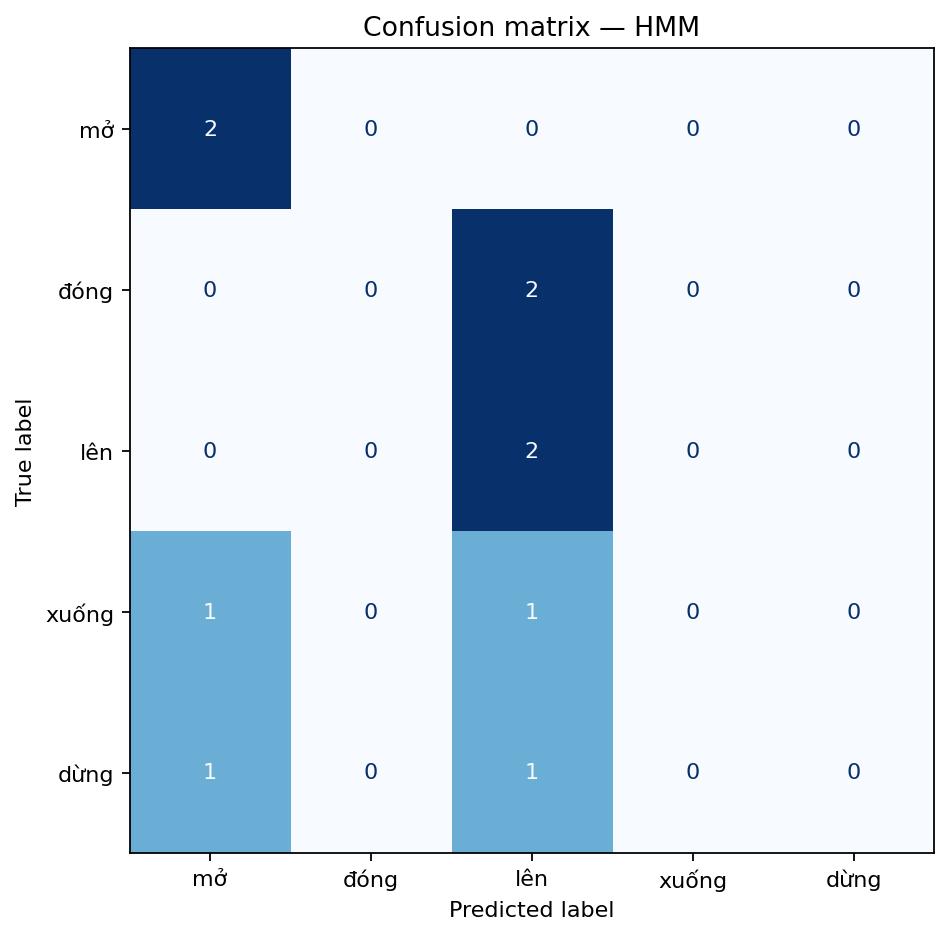
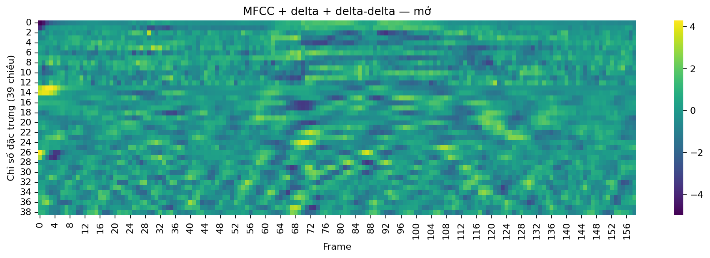
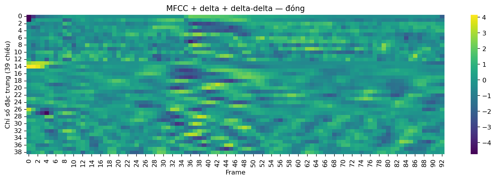
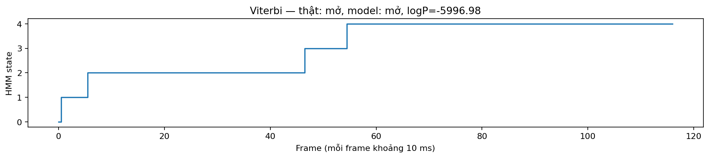
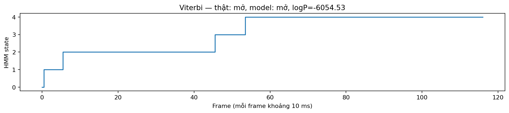

# LAB 3 — Nhận dạng tiếng nói nâng cao với HMM

**Học phần:** CSE457 — Xử lý âm thanh và tiếng nói  
**Chủ đề:** MFCC động, Gaussian Hidden Markov Model (HMM), Forward/Viterbi, đánh giá nhận dạng và mở rộng Language Model.

> README này tổng hợp yêu cầu trong `Lab 3.pdf` và các mã nguồn/kết quả được lưu trong thư mục `TH3`. Các số liệu được trích từ kết quả chạy đã lưu; do tập test nhỏ và một số lần chạy thí nghiệm cho kết quả khác nhau, báo cáo ghi rõ cấu hình/kết quả tương ứng thay vì khẳng định khả năng tổng quát hóa.

## 1. Mục tiêu

- Chuẩn hóa dữ liệu tiếng nói và trích xuất đặc trưng MFCC tĩnh, delta và delta-delta.
- Huấn luyện bộ phân loại lệnh tiếng Việt bằng Gaussian HMM trái-sang-phải (left-to-right).
- Nhận dạng bằng log-likelihood, quan sát Viterbi alignment và confusion matrix.
- So sánh HMM với baseline DTW, thử nghiệm số trạng thái, chiều đặc trưng, nhiễu và bigram re-ranking.
- Xây dựng lexicon minh họa và ghi nhận giới hạn của thí nghiệm.

## 2. Công nghệ sử dụng

- Python, NumPy, Pandas
- `librosa`, `soundfile` — đọc/xử lý âm thanh và trích xuất MFCC
- `hmmlearn` — Gaussian HMM
- `scikit-learn` — các chỉ số đánh giá
- Matplotlib, Seaborn — trực quan hóa
- Joblib — lưu mô hình đã huấn luyện

Cài đặt các thư viện chính:

```bash
pip install numpy pandas scipy matplotlib seaborn librosa soundfile scikit-learn hmmlearn joblib
```

## 3. Dữ liệu

Bài toán nhận dạng 5 lệnh tiếng Việt:

| Nhãn trong mã | Lệnh |
|---|---|
| `mo` | mở |
| `dong` | đóng |
| `len` | lên |
| `xuong` | xuống |
| `dung` | dừng |

Dữ liệu trong gói gồm **30 file train** (6 file/lớp) và **10 file test** (2 file/lớp), tổng cộng 40 utterance. Kết quả kiểm tra manifest cho thấy các file âm thanh có sample rate **16 kHz**, **mono**. Các file test được tách riêng khỏi train theo thư mục.

Cấu trúc chính:

```text
TH3/
├── code.ipynb
├── transfer.py
├── corpus_commands.txt
├── lexicon.txt
├── data/
│   ├── train/{mo,dong,len,xuong,dung}/
│   └── test/{mo,dong,len,xuong,dung}/
├── models/
│   ├── hmm_mo.joblib
│   ├── hmm_dong.joblib
│   ├── hmm_len.joblib
│   ├── hmm_xuong.joblib
│   └── hmm_dung.joblib
└── results/
    ├── audio_manifest.csv
    ├── confusion_matrix_hmm.png
    ├── heatmap_mo_1.png
    ├── heatmap_dong_1.png
    ├── viterbi_mo_7_mo.png
    ├── viterbi_mo_8_mo.png
    ├── likelihood_scores.csv
    ├── dtw_scores.csv
    ├── dtw_vs_hmm.csv
    ├── experiment_n_states.csv
    ├── experiment_feature_dims.csv
    ├── noise_robustness.csv
    ├── lm_reranking_summary.csv
    └── summary.json
```

## 4. Phương pháp

### 4.1 Tiền xử lý và đặc trưng

Pipeline đọc âm thanh, chuyển về mono và 16 kHz nếu cần, cắt đoạn im lặng, sau đó trích xuất 13 MFCC. Khi bật đặc trưng động, ghép thêm 13 delta và 13 delta-delta:

\[
\mathbf{x}_t=[\mathbf{c}_t,\Delta\mathbf{c}_t,\Delta^2\mathbf{c}_t]\in\mathbb{R}^{39}
\]

Chuỗi đặc trưng được chuẩn hóa CMVN theo utterance. Số frame có thể khác nhau giữa các file; HMM xử lý chuỗi có độ dài biến đổi.

### 4.2 Mô hình HMM

Mỗi lệnh có một whole-word Gaussian HMM với 5 trạng thái và `covariance_type="diag"`. Trạng thái bắt đầu được đặt tại state đầu tiên; topology hướng trái-sang-phải cho phép ở lại state hiện tại hoặc chuyển sang state kế tiếp. Hiệp phương sai đường chéo giảm số tham số cần ước lượng, phù hợp hơn khi dữ liệu huấn luyện hạn chế so với full covariance.

Các mô hình đã lưu trong `models/`. Notebook cũng kiểm tra `startprob_`, `transmat_` và tổng xác suất chuyển lùi. Cần lưu ý rằng kết quả huấn luyện có thể phụ thuộc phiên bản `hmmlearn`, cách khởi tạo và ràng buộc ma trận chuyển.

### 4.3 Nhận dạng và căn chỉnh

Với mỗi utterance test, tính log-likelihood dưới từng mô hình; mô hình có score cao nhất là dự đoán:

\[
\hat{w}=\arg\max_w \log P(X\mid\lambda_w)
\]

Viterbi được dùng để tìm đường trạng thái tốt nhất. Forward và Viterbi không giống nhau: Forward cộng xác suất của mọi đường trạng thái hợp lệ để tính likelihood, còn Viterbi chọn đường có xác suất lớn nhất.

### 4.4 DTW và Language Model

Baseline DTW sử dụng MFCC tĩnh 13 chiều và một template cho mỗi lớp. Phần mở rộng LM tạo thống kê unigram/bigram từ `corpus_commands.txt`, dùng add-k smoothing và thử các trọng số \(\lambda_{LM}\) bằng cách cộng điểm ngôn ngữ với acoustic score. `lexicon.txt` là **lexicon minh họa**; chuỗi phone cần được thay/đối chiếu với inventory phiên âm chính thức do giảng viên cung cấp trước khi dùng cho mô hình subword thực tế.

## 5. Kết quả

### 5.1 Tóm tắt kết quả đã lưu

Theo `results/summary.json` và `results/dtw_vs_hmm.csv`:

| Phương pháp | Đặc trưng | Accuracy test | Số mẫu test |
|---|---|---:|---:|
| Gaussian HMM | MFCC + Δ + Δ² (39D) | 40% (4/10) | 10 |
| DTW baseline | MFCC tĩnh (13D), 1 template/lớp | 90% (9/10) | 10 |

Kết quả HMM trong lần chạy được lưu tại summary thấp hơn DTW baseline. Đây là kết quả trên tập test rất nhỏ, chỉ có 2 mẫu mỗi lớp, nên một vài dự đoán sai có thể làm accuracy thay đổi mạnh.

### 5.2 Confusion matrix HMM



Trong báo cáo notebook, lớp **mở** và **lên** được nhận diện đúng ở cả hai mẫu; các mẫu thuộc **đóng**, **xuống** và **dừng** bị nhầm sang lớp khác. Điều này phù hợp với accuracy 40% (4/10) được ghi trong summary. Hãy dùng ma trận ở trên để kiểm tra cụ thể hướng nhầm lẫn giữa các lớp.

### 5.3 Heatmap đặc trưng

| Lệnh “mở” | Lệnh “đóng” |
|---|---|
|  |  |

Heatmap hiển thị các hệ số đặc trưng theo thời gian. MFCC mô tả cấu trúc phổ ngắn hạn; delta mô tả xu hướng thay đổi và delta-delta mô tả thay đổi của xu hướng. Sự khác biệt theo frame là tín hiệu bổ sung cho việc phân biệt các lệnh.

### 5.4 Viterbi alignment

| `mo_7.wav` | `mo_8.wav` |
|---|---|
|  |  |

Đường trạng thái cho biết state mà thuật toán Viterbi gán cho từng frame. Với topology trái-sang-phải hợp lệ, đường đi không nên chuyển lùi. Các đoạn nằm ngang dài hơn thể hiện nhiều frame được gán vào cùng một state; không nên coi state là một phoneme cụ thể nếu không có huấn luyện/giám sát ở mức phoneme.

### 5.5 Thử nghiệm số trạng thái

Theo `results/experiment_n_states.csv`:

| Số state | Accuracy test | Thời gian train tổng (giây) |
|---:|---:|---:|
| 3 | 80% (8/10) | 0.141 |
| 5 | 100% (10/10) | 0.261 |
| 7 | 100% (10/10) | 0.247 |

Trong lần chạy thí nghiệm này, 5 state đạt accuracy test 100%, và 7 state không cải thiện thêm. Tuy nhiên, kết quả này khác với accuracy 40% của cấu hình mặc định được ghi trong `summary.json`; có thể các ô notebook được chạy lại với trạng thái khởi tạo/tham số khác nhau. Vì vậy không nên gộp các con số này thành một kết quả duy nhất. Cần chạy lại notebook từ đầu với seed, tham số và pipeline cố định để tạo bảng cuối cùng nhất quán.

### 5.6 So sánh chiều đặc trưng

Theo `results/experiment_feature_dims.csv`:

| Đặc trưng | Accuracy test của lần chạy thí nghiệm |
|---|---:|
| MFCC 13D | 100% |
| MFCC + delta + delta-delta 39D | 100% |

Ở lần chạy này, hai cấu hình có cùng accuracy. Với 10 mẫu test, chưa thể kết luận đặc trưng 39D tốt hơn hoặc kém hơn; nên kiểm tra thêm confusion matrix, nhiều lần chia dữ liệu hoặc dữ liệu từ người nói khác.

### 5.7 Bigram re-ranking

Theo `results/lm_reranking_summary.csv`, accuracy trong lần chạy đã lưu là 40% ở cả bốn giá trị trọng số:

| \(\lambda_{LM}\) | Accuracy |
|---:|---:|
| 0.0 | 40% |
| 0.1 | 40% |
| 0.3 | 40% |
| 1.0 | 40% |

Trong thí nghiệm này, re-ranking không cải thiện accuracy. Corpus lệnh nhỏ nên ước lượng xác suất ngôn ngữ còn hạn chế; nếu trọng số LM quá lớn, prior ngôn ngữ có thể lấn át bằng chứng âm học. Với bài toán một từ độc lập, ngữ cảnh từ trước cũng không nhiều thông tin nếu không có ngữ cảnh thực sự.

### 5.8 Robustness với nhiễu

Notebook thử thêm nhiễu trắng tổng hợp ở SNR 15 dB. Accuracy sạch được ghi là 40%, và accuracy nhiễu cũng là 40%. Kết quả từng file được lưu tại `results/noise_robustness.csv`. Do tập test nhỏ, kết quả này chỉ mô tả lần thử hiện tại, chưa đủ để khẳng định hệ thống bền vững với nhiễu.

## 6. Đối chiếu yêu cầu Lab

| Yêu cầu trong Lab 3 | Trạng thái trong gói TH3 |
|---|---|
| Kiểm tra dữ liệu, mono/16 kHz, train/test split | Có manifest và kiểm tra số lượng |
| MFCC, delta, delta-delta; heatmap ít nhất 2 từ | Có; lưu hai heatmap trong `results/` |
| Whole-word Gaussian HMM, kiểm tra transition | Có; lưu 5 model và kiểm tra ma trận chuyển |
| Likelihood và dự đoán test | Có bảng `likelihood_scores.csv` |
| Ít nhất 2 Viterbi path plots | Có 2 hình cho `mo_7.wav` và `mo_8.wav` |
| Confusion matrix và accuracy | Có |
| So sánh DTW với HMM | Có bảng `dtw_vs_hmm.csv` |
| Thử số state 3/5/7 | Có `experiment_n_states.csv` |
| MFCC 13D so với 39D | Có `experiment_feature_dims.csv` |
| Bigram re-ranking với nhiều trọng số | Có `lm_reranking_summary.csv` |
| Thử robustness với nhiễu | Có `noise_robustness.csv` |
| Lexicon mini | Có `lexicon.txt`, hiện ghi rõ là minh họa |
| Phân tích mismatch người nói/microphone | Chưa thấy kết quả thí nghiệm riêng trong các kết quả đã lưu |

## 7. Cách chạy

1. Giải nén thư mục `TH3`.
2. Cài các thư viện ở mục 2 trong môi trường Python/Jupyter.
3. Mở `code.ipynb` bằng Jupyter Notebook hoặc VS Code.
4. **Kiểm tra và sửa `PROJECT_DIR`/đường dẫn dữ liệu** ở cell cấu hình đầu tiên cho khớp vị trí thư mục `TH3` trên máy.
5. Chạy notebook từ đầu đến cuối để tạo lại manifest, đặc trưng, model và các kết quả trong `results/`.

Ví dụ chạy Jupyter:

```bash
jupyter notebook code.ipynb
```

Mô hình đã serialize nằm trong `models/`. Các kết quả dạng bảng CSV và ảnh trực quan nằm trong `results/`. Không nên chỉ dựa vào các model `.joblib` đã lưu nếu môi trường/thư viện khác phiên bản; có thể cần huấn luyện lại.

## 8. Kết luận

TH3 đã xây dựng pipeline nhận dạng 5 lệnh tiếng Việt với MFCC động 39 chiều, Gaussian HMM trái-sang-phải, đánh giá bằng likelihood/confusion matrix, trực quan hóa Viterbi, baseline DTW và thử nghiệm mở rộng với bigram re-ranking và nhiễu. Trong kết quả summary hiện lưu, DTW đạt 90% còn HMM đạt 40%; một số thí nghiệm notebook chạy lại cho kết quả khác, vì vậy bước cần làm trước khi nộp là tái chạy toàn bộ notebook trong môi trường sạch và cập nhật lại bảng/hình theo cùng một lần chạy.

